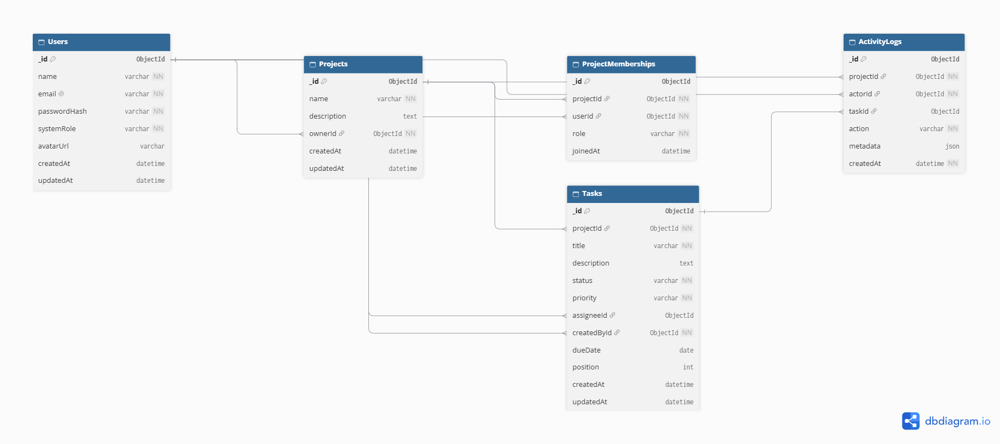

# TaskMatrix — Agile Project Management Platform

> **Sprint 13 | Fullstack Developer Track | Product Requirements Document (PRD)**

TaskMatrix is a proposed web-based project management platform designed to help teams organize projects, assign tasks, track progress, manage deadlines, and collaborate through a centralized workspace.

This repository contains the Sprint 13 planning and design deliverables, including the Product Requirements Document, Figma wireframes, MongoDB Entity Relationship Diagram (ERD), system architecture, and AI-assisted planning history.

**Project status:** Planning and UI/UX design. Functional application development is planned for subsequent sprints.

---

## Table of Contents

- [1. Project Overview](#1-project-overview)
- [2. Problem Statement](#2-problem-statement)
- [3. Objectives](#3-objectives)
- [4. Designated Track](#4-designated-track)
- [5. Technology Stack](#5-technology-stack)
- [6. User Roles and Permissions](#6-user-roles-and-permissions)
- [7. Functional Requirements and Priorities](#7-functional-requirements-and-priorities)
- [8. Non-Functional Requirements](#8-non-functional-requirements)
- [9. Core User Flows](#9-core-user-flows)
- [10. Proposed Database Design](#10-proposed-database-design)
- [11. UI/UX Design Deliverables](#11-uiux-design-deliverables)
- [12. System Architecture](#12-system-architecture)
- [13. Success Criteria](#13-success-criteria)
- [14. Delivery Roadmap](#14-delivery-roadmap)
- [15. Development and Deployment Plan](#15-development-and-deployment-plan)
- [16. Risks and Mitigation](#16-risks-and-mitigation)
- [17. Scope and Non-Goals](#17-scope-and-non-goals)
- [18. Repository Structure](#18-repository-structure)
- [19. AI-Assisted Development Documentation](#19-ai-assisted-development-documentation)
- [20. Current Status and Next Steps](#20-current-status-and-next-steps)

---

## 1. Project Overview

**Project name:** TaskMatrix

**Project type:** Fullstack web application

**Category:** Agile project management and team collaboration

**Intended users:** Project managers, administrators, and team members

TaskMatrix aims to provide a single workspace where teams can create projects, organize work into tasks, assign responsibilities, set deadlines, track task statuses, and view project activity.

The platform is planned as a responsive Single Page Application (SPA), supported by a REST API, a MongoDB database, and real-time communication capabilities.

### Project vision

To simplify project coordination by giving teams a clear, centralized view of their work, responsibilities, priorities, and deadlines.

## 2. Problem Statement

Teams often use separate tools for task lists, project tracking, deadlines, and communication. This can make it difficult to maintain visibility into project progress, identify overdue tasks, and understand recent changes.

TaskMatrix aims to address these problems through:

- Centralized project and task management.
- Clear task ownership and status tracking.
- Project-level access control.
- Deadline and priority visibility.
- Real-time activity updates.
- A responsive interface for desktop and mobile devices.

## 3. Objectives

The primary objectives are to:

1. Provide secure user authentication and authorization.
2. Enable users to create and manage projects.
3. Support project membership and role-based permissions.
4. Provide task creation, assignment, updating, and deletion.
5. Organize tasks using a Kanban-style workflow.
6. Display task priorities, due dates, and progress.
7. Provide a dashboard for project and task summaries.
8. Support real-time updates for relevant project activity.
9. Maintain a structured, secure, and maintainable fullstack architecture.
10. Deliver the application incrementally through the planned sprint roadmap.

---

## 4. Designated Track

**Fullstack Developer**

The project covers the planned development lifecycle of a fullstack application:

- Frontend interface and client-side navigation.
- Backend REST API development.
- Database design and integration.
- Authentication and authorization.
- Real-time communication.
- Input validation and error handling.
- Testing, documentation, and deployment.

## 5. Technology Stack

The following stack is proposed for implementation.

| Layer | Technology | Purpose |
|---|---|---|
| Frontend | React | Component-based user interface |
| Build tool | Vite | Frontend development and production builds |
| Styling | Tailwind CSS | Responsive styling and layout |
| UI components | shadcn/ui | Reusable interface components |
| Routing | React Router | Client-side navigation |
| Backend | Node.js | JavaScript runtime |
| API framework | Express.js | REST API and middleware |
| Database | MongoDB Atlas | Persistent application data |
| ODM | Mongoose | MongoDB schemas and data access |
| Authentication | JWT | Token-based authentication |
| Password security | bcrypt or bcryptjs | Secure password hashing |
| Real-time communication | Socket.IO | Real-time project activity and updates |
| UI/UX design | Figma | Wireframes and design system |
| Database modeling | dbdiagram.io | Entity Relationship Diagram |
| Architecture diagrams | Draw.io / diagrams.net | System architecture visualization |
| Version control | Git and GitHub | Source control and collaboration |
| Frontend deployment | Vercel | Planned frontend hosting |
| Backend deployment | Render | Planned backend hosting |

The stack represents the proposed implementation architecture. Individual technologies and features should be marked as implemented only after they have been developed and verified.

---

## 6. User Roles and Permissions

### 6.1 Administrator

The Administrator is responsible for platform-level administration.

Planned responsibilities:

- Manage administrative functions.
- Maintain platform security and configuration.
- Access administrative capabilities according to defined authorization rules.

Administrative access should not automatically expose private project data unless explicitly permitted by the application's authorization policy.

### 6.2 Project Manager

The Project Manager manages projects and coordinates team work.

Planned permissions:

- Create and update projects.
- Invite or add project members.
- Assign project roles.
- Create, assign, update, and delete project tasks.
- Set task priorities and deadlines.
- Monitor task status and project progress.
- Review project activity and overdue work.

### 6.3 Team Member

The Team Member works on assigned project tasks.

Planned permissions:

- View projects to which they have access.
- View tasks within authorized projects.
- Update permitted task fields and task status.
- Track personal assignments and deadlines.
- Participate in permitted collaboration activities.

### Authorization principle

The backend must enforce authorization on every protected operation. Hiding a button in the frontend is not sufficient to protect a resource.

Project membership and role permissions must be checked server-side before allowing access to project data.

---

## 7. Functional Requirements and Priorities

Features are grouped into three priorities to keep the initial release achievable.

### P0 — Minimum Viable Product (MVP)

| ID | Requirement | Acceptance expectation |
|---|---|---|
| FR-01 | User authentication | Users can register or sign in through validated forms. |
| FR-02 | Authorization | Protected resources are accessible only to authorized users. |
| FR-03 | Project management | Authorized users can create, view, update, and delete projects according to their permissions. |
| FR-04 | Project membership | Project members and their roles can be managed according to permissions. |
| FR-05 | Task management | Authorized users can create, view, update, and delete tasks. |
| FR-06 | Task assignment | Tasks can be assigned to eligible project members. |
| FR-07 | Kanban workflow | Tasks can be organized by status. |
| FR-08 | Priority labels | Tasks display their priority. |
| FR-09 | Due dates | Tasks can have deadlines, and overdue tasks can be identified. |
| FR-10 | Dashboard | Users can view relevant project, task, and progress summaries. |
| FR-11 | Responsive UI | Core screens remain usable on desktop and mobile devices. |

### P1 — Important Enhancements

| ID | Requirement | Acceptance expectation |
|---|---|---|
| FR-12 | Drag-and-drop Kanban | Authorized task status changes are persisted after a card is moved. |
| FR-13 | Real-time activity | Relevant authorized users receive appropriate project activity updates. |
| FR-14 | Deadline reminders | Due or overdue tasks can trigger scheduled reminders according to the configured rules. |
| FR-15 | Search | Users can find accessible projects or tasks using supported search criteria. |
| FR-16 | Filtering and sorting | Task lists can be filtered and sorted by supported fields. |

### P2 — Additional Enhancements

| ID | Requirement | Acceptance expectation |
|---|---|---|
| FR-17 | Comments | Authorized users can collaborate through task-related comments. |
| FR-18 | Productivity statistics | The dashboard can show useful task and project statistics. |
| FR-19 | Accessibility improvements | Controls, forms, and navigation receive accessibility improvements. |
| FR-20 | UI polish | Loading states, empty states, validation feedback, and error messages are consistent. |

P1 and P2 features should be implemented only after the MVP foundation is stable.

---

## 8. Non-Functional Requirements

### 8.1 Security

- Hash passwords securely; never store plaintext passwords.
- Keep secrets and database credentials in environment variables.
- Validate and sanitize user input.
- Enforce authentication and authorization on protected backend routes.
- Restrict access to project data according to membership and permissions.
- Configure CORS for trusted frontend origins.
- Avoid returning sensitive information in API responses or logs.

### 8.2 Reliability

- Return consistent API responses and appropriate HTTP status codes.
- Handle database errors and invalid requests safely.
- Provide useful frontend loading, empty, success, and error states.
- Prevent unauthorized or invalid task and project modifications.

### 8.3 Performance

- Retrieve only the data needed for each view.
- Use appropriate database indexes when supported by query patterns.
- Avoid unnecessary frontend requests and renders.
- Consider pagination for growing task and activity lists.

### 8.4 Maintainability

- Separate frontend and backend responsibilities.
- Keep API routes, validation, services, and data access logically organized.
- Use reusable UI components.
- Document setup instructions, environment variables, and API behavior.

### 8.5 Accessibility and responsiveness

- Support readable text, adequate contrast, and visible focus states.
- Use labels and accessible form controls.
- Ensure core interactions work on mobile and desktop.
- Avoid relying exclusively on color to communicate status or priority.

---

## 9. Core User Flows

### Flow 1: Authentication

1. A user opens the application.
2. The user selects the login or registration option.
3. The frontend validates required form fields.
4. The backend validates the request and performs the relevant authentication operation.
5. On success, the user is taken to the appropriate workspace.
6. On failure, the user receives a clear error message.

### Flow 2: Create a project

1. An authorized user opens the dashboard.
2. The user selects **Create Project**.
3. The user enters the project name and description.
4. The frontend validates the form.
5. The backend verifies authorization and saves the project.
6. The dashboard displays the newly created project.

### Flow 3: Add project members

1. A Project Manager opens a project.
2. The manager selects the member-management action.
3. The manager selects an eligible user and assigns a permitted role.
4. The backend verifies the manager's permissions.
5. The membership is persisted.
6. The new member can access the project according to their role.

### Flow 4: Create and assign a task

1. An authorized user opens a project board.
2. The user selects **Add Task**.
3. The user enters the task title, description, assignee, priority, status, and due date as applicable.
4. The backend validates the data and checks project membership.
5. The task is saved to the database.
6. The updated task appears on the board.

### Flow 5: Update task status

1. A user opens a Kanban board.
2. The user changes a task's status.
3. The backend checks the user's authorization.
4. The updated status is persisted.
5. The UI reflects the saved status.
6. Relevant authorized users may receive a real-time update when that feature is implemented.

### Flow 6: Review activity and deadlines

1. A user opens an authorized project or dashboard.
2. The application displays available task and activity information.
3. Overdue and upcoming tasks are identified.
4. Scheduled deadline reminders and real-time activity are delivered when the corresponding features are implemented.

---

## 10. Proposed Database Design

TaskMatrix is planned to use MongoDB Atlas with Mongoose.

### 10.1 Collections

| Collection | Purpose | Important relationships |
|---|---|---|
| `Users` | Stores user profile and authentication-related information. | Referenced by memberships, task assignments, and activity records. |
| `Projects` | Stores project details, ownership, and metadata. | Connected to project memberships, tasks, and activity records. |
| `ProjectMemberships` | Records users' membership and roles within projects. | References a user and a project. |
| `Tasks` | Stores task details, status, priority, assignee, and deadline. | References a project and relevant users. |
| `ActivityLogs` | Records project actions and relevant activity metadata. | References the actor and, where applicable, the associated project or task. |

### 10.2 Relationship overview

- One user can participate in multiple projects.
- One project can contain multiple members.
- `ProjectMemberships` represents the relationship between users and projects.
- One project can contain multiple tasks.
- A task can be assigned to an eligible project member.
- A project can have multiple activity records.
- Activity records can reference the user who performed an action and the related resource.

The final Mongoose schemas, field names, validation rules, indexes, and deletion behavior will be determined during implementation.

### 10.3 Database ERD

The following image shows the planned MongoDB collection relationships.



**Editable source:** Retain the corresponding dbdiagram.io diagram or exported source in the project documentation.

---

## 11. UI/UX Design Deliverables

The UI/UX work is planned in Figma, with desktop and mobile wireframes and a reusable design system.

### 11.1 Authentication

The authentication wireframe includes:

- TaskMatrix branding.
- Login and sign-up modes.
- Email and password fields.
- Primary login action.
- Supporting text and form-state placeholders.
- Validation and loading-state examples.

### 11.2 Workspace Dashboard

The dashboard wireframe includes:

- Workspace navigation.
- Welcome section.
- Task and project overview cards.
- Project cards with progress indicators.
- Upcoming deadlines.
- Recent activity.
- A primary action for creating a project.

### 11.3 Project Board and Task Details

The project board wireframe includes:

- Project navigation.
- Search and filtering controls.
- Kanban status columns.
- Task cards with priority and assignment information.
- An Add Task action.
- A task-details panel with status, assignee, priority, due date, and description.

### 11.4 Design System

The design system documents:

- Color palette.
- Typography.
- Spacing and sizing.
- Buttons and interactive controls.
- Form fields and validation states.
- Status and priority badges.
- Task and project cards.
- Navigation patterns.
- Responsive layout guidance.

### 11.5 Figma Design File

**Figma URL:** https://www.figma.com/design/Gj1rfNYzXJreIuS275mDy7/TaskMatrix-%E2%80%94-Sprint-13-UI-UX-Design?node-id=1-2&t=oB5Ua7wcI4vMIoUW-1

https://www.figma.com/design/Gj1rfNYzXJreIuS275mDy7/TaskMatrix-%E2%80%94-Sprint-13-UI-UX-Design?node-id=1-3&t=oB5Ua7wcI4vMIoUW-1

https://www.figma.com/design/Gj1rfNYzXJreIuS275mDy7/TaskMatrix-%E2%80%94-Sprint-13-UI-UX-Design?node-id=1-4&t=oB5Ua7wcI4vMIoUW-1
## 12. System Architecture

The proposed architecture separates the frontend, backend, and database responsibilities.

### 12.1 Frontend

The React application is planned to handle:

- Page rendering and client-side navigation.
- Forms and input validation.
- Dashboard and Kanban interfaces.
- REST API requests.
- Loading, success, empty, and error states.
- Socket.IO client connections for supported real-time features.

### 12.2 Backend

The Node.js and Express backend is planned to handle:

- REST API endpoints.
- Authentication and authorization.
- Request validation.
- Project and task business logic.
- Database access through Mongoose.
- Activity recording.
- Socket.IO server connections and authorized event delivery.
- Scheduled deadline checking when that feature is implemented.

### 12.3 Database

MongoDB Atlas is planned to persist user, project, membership, task, and activity data.

### 12.4 Real-time communication

Socket.IO is planned for relevant real-time activity and task updates.

Real-time events must be restricted to users authorized to access the associated project. Database changes and authorization checks remain the responsibility of the backend.

### 12.5 System Architecture Diagram


**Deployment plan:** Vercel for the frontend, Render for the backend, and MongoDB Atlas for managed database hosting.

The diagram describes the proposed architecture. It does not imply that the application or its planned services have already been implemented or deployed.

---

## 13. Success Criteria

The MVP will be considered ready for acceptance when the following criteria are verified.

### Authentication and authorization

- Valid users can complete the supported authentication flow.
- Invalid authentication requests are rejected safely.
- Protected endpoints reject unauthenticated requests.
- Users cannot access projects or tasks outside their authorized scope.

### Project management

- Authorized users can create, view, update, and delete projects according to defined rules.
- Project membership changes are persisted.
- Project access follows membership and role permissions.

### Task management

- Authorized users can create, view, update, and delete tasks.
- Task assignments reference eligible users.
- Status, priority, and due-date changes are persisted.
- Invalid input is rejected with appropriate feedback.

### Dashboard and user experience

- Dashboard summaries reflect available database records.
- Task and project views show loading, empty, and error states appropriately.
- Core screens remain usable on supported mobile and desktop sizes.
- Successful changes are reflected in the UI without requiring an unnecessary full-page reload.

### Data and integration

- The API reads and writes the expected MongoDB collections.
- Errors are handled without exposing credentials or sensitive data.
- The frontend and backend communicate through the configured API URL.
- Real-time updates and scheduled reminders are tested if included in the accepted release scope.

### Documentation and delivery

- The README accurately describes the project and its current status.
- The ERD and system architecture images render in GitHub.
- The Figma link opens the actual design file.
- Environment variables and setup instructions are documented.
- The final application passes the agreed manual and automated tests.

---

## 14. Delivery Roadmap

The following roadmap is the planned sprint sequence.

| Sprint | Focus | Expected deliverables |
|---|---|---|
| Sprint 13 | Planning and UI/UX design | PRD, wireframes, design system, database ERD, system architecture, prompt documentation. |
| Sprint 14 | MVP implementation | Authentication foundation, project management, database integration, and core task CRUD. |
| Sprint 15 | Feature completion | Task workflows, membership and permissions, CRUD pipelines, and relevant integrations. |
| Sprint 16 | AI integration and UX polish | Planned AI features, improved usability, accessibility, and interface refinement. |
| Sprint 17 | CI/CD and go-live | Testing, deployment automation, production configuration, and release verification. |

The exact features assigned to each implementation sprint may be refined according to the company brief and the results of earlier milestones.

---

## 15. Development and Deployment Plan

### 15.1 Development approach

Development will proceed incrementally:

1. Review the requirements and existing design.
2. Implement one focused feature at a time.
3. Verify the affected frontend, backend, and database behavior.
4. Test successful and unsuccessful cases.
5. Record meaningful changes in Git.
6. Update documentation when behavior or architecture changes.
7. Avoid unrelated rewrites during focused implementation work.

### 15.2 Environment configuration

Sensitive configuration must be stored in environment variables.

Examples of planned configuration keys include:

- `MONGODB_URI`
- `JWT_SECRET`
- `CLIENT_URL`
- `PORT`

Actual variable names must match the implementation.

A `.env.example` file should document required variable names with safe placeholder values. The real `.env` file must not be committed to GitHub.

### 15.3 Deployment strategy

**Frontend:** Vercel

**Backend:** Render

**Database:** MongoDB Atlas

Before deployment:

- Configure the production frontend API URL.
- Configure the backend's trusted frontend origin.
- Set production secrets in the hosting environment.
- Confirm database network access and credentials.
- Test API connectivity and database operations.
- Verify production logs and error handling.
- Confirm that secrets are not exposed in frontend code or Git history.

Deployment will be completed during the appropriate implementation and release sprints.

---

## 16. Risks and Mitigation

| Risk | Potential impact | Mitigation |
|---|---|---|
| Scope creep | Delayed MVP delivery. | Prioritize P0 features and defer optional enhancements. |
| Authorization errors | Unauthorized access to project data. | Enforce backend permission checks and test negative cases. |
| Incorrect database relationships | Inconsistent memberships, assignments, or activity records. | Review the ERD and validate references during implementation. |
| Real-time event leakage | Users receive events for projects they cannot access. | Apply authenticated connections and project-level event authorization. |
| Invalid input | Incorrect or unsafe stored data. | Validate requests on the backend and provide useful client-side feedback. |
| Integration failures | Frontend and backend cannot communicate correctly. | Test API endpoints, CORS, environment variables, and error responses. |
| Deployment configuration mistakes | Production application failures. | Maintain separate environment configurations and verify deployment settings. |
| Limited testing time | Undetected regressions. | Test each milestone incrementally and reserve time for final verification. |
| AI-generated inconsistencies | Incorrect files, dependencies, or documentation. | Review generated changes, preserve architecture, and verify the actual result. |

---

## 17. Scope and Non-Goals

### In scope

- A responsive project management web application.
- User authentication and authorization.
- Projects and project memberships.
- Task CRUD and assignment.
- Kanban task statuses.
- Priorities and due dates.
- Dashboard summaries.
- Planned real-time activity.
- Planned deadline reminders.
- Search, filtering, and sorting.
- Documentation, testing, and deployment.

### Non-goals for the initial MVP

- A full enterprise resource planning system.
- A replacement for every communication and collaboration platform.
- Complex billing or subscription management.
- Advanced enterprise analytics.
- Unrestricted cross-project administration.
- Large-scale microservices infrastructure.
- Optional integrations that do not support the core project goals.

Features beyond the agreed MVP should be considered only after the core workflows are stable.

---

## 18. Repository Structure

The planning repository is expected to contain the following documentation:

```text
prodesk-capstone-taskmatrix/
├── README.md
├── Prompts.md
└── docs/
    ├── taskmatrix-erd.png
    ├── system-architecture.png
    └── TaskMatrix-System-Architecture.drawio
```

This is the intended documentation layout. Keep the actual filenames consistent with the files present in the repository. Add the editable ERD source file if it is available, and retain the architecture diagram's native source for future edits.

The functional frontend and backend source code will be added during subsequent implementation sprints according to the company's repository requirements.

---

## 19. AI-Assisted Development Documentation

AI tools may be used to support planning, design, architecture documentation, debugging, and concept explanations.

`Prompts.md` records the prompts used during the planning process and summarizes the resulting changes.

AI-generated output must be reviewed before it is accepted into the project. The repository should reflect actual work completed, not assumed functionality or invented debugging history.

Important practices:

- Keep prompts focused on a single objective.
- Inspect existing files before making changes.
- Preserve working structure and naming conventions.
- Verify generated diagrams and Markdown links.
- Record meaningful changes and test outcomes.
- Never commit credentials, API keys, or private environment files.

---

## 20. Current Status and Next Steps

### Sprint 13 deliverables

- [x] Product requirements documented in `README.md`.
- [x] Desktop wireframes prepared in Figma.
- [x] Mobile wireframes prepared in Figma.
- [x] Design system documented in Figma.
- [x] MongoDB ERD exported to `docs/taskmatrix-erd.png`.
- [x] System architecture diagram exported to `docs/system-architecture.png`.
- [x] AI-assisted planning history maintained in `Prompts.md`.

### Final verification still required

- [ ] Replace the Figma URL placeholder with the actual share link.
- [ ] Confirm both diagram images render correctly in GitHub.
- [ ] Confirm all documentation files and diagram sources are committed.
- [ ] Verify the final repository is accessible to the intended reviewer.
- [ ] Confirm submission requirements and provide the actual repository and design links.

The checklist describes the expected planning deliverables; each item should be checked only after the corresponding file or link has been verified.

---

## Conclusion

TaskMatrix is planned as a fullstack project management platform that combines project organization, task workflows, access control, deadline visibility, and real-time collaboration.

Sprint 13 establishes the requirements, UI/UX direction, data model, and architecture needed to begin implementation in the following sprints.

The next phase is to build the MVP incrementally, validate each feature against the requirements, and maintain the documentation as the project evolves.
